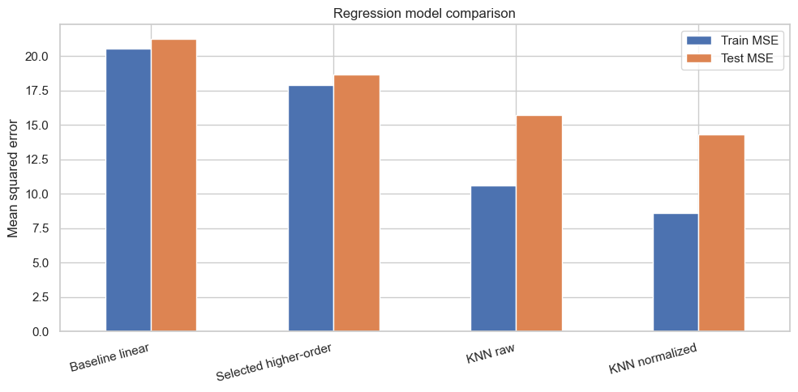

# Power Plant Energy Output Prediction

This project compares linear and non-linear regression methods for predicting the net hourly electrical output of a combined-cycle power plant. It was completed as coursework for **USC DSCI 552: Machine Learning for Data Science**.

## Question

How accurately can ambient operating conditions predict electrical output, and does a flexible model improve enough over ordinary linear regression to justify the added complexity?

## Data

The [UCI Combined Cycle Power Plant dataset](https://archive.ics.uci.edu/dataset/294/combined+cycle+power+plant) contains **9,568 observations** collected while the plant operated at full load.

- Predictors: ambient temperature (`AT`), exhaust vacuum (`V`), ambient pressure (`AP`), and relative humidity (`RH`)
- Target: net hourly electrical energy output (`PE`)
- Missing values: none in the supplied workbook

The observations cover a limited operating regime, so performance should not be assumed to transfer to other plants or substantially different environmental conditions.

## Approach

1. Explored each predictor and fitted four simple linear regressions.
2. Fitted a multiple linear regression baseline.
3. Added quadratic and pairwise interaction terms to test for non-linearity.
4. Compared raw and normalized K-nearest-neighbor regression, selecting `k` with validation data.
5. Evaluated the final models on a held-out test set using mean squared error (MSE).

## Results

Temperature was the strongest individual linear predictor (`R² = 0.899`). Combining all four predictors increased training `R²` to `0.929`. The normalized KNN model produced the lowest held-out error.

| Model | Test MSE |
| --- | ---: |
| Multiple linear regression | 21.240 |
| Quadratic and interaction regression | 18.660 |
| KNN on raw predictors (`k = 5`) | 15.727 |
| **KNN on normalized predictors (`k = 4`)** | **14.306** |



## What I learned

The higher-order linear model improved on the baseline, which suggests that the relationship is not fully linear. KNN improved further, but only after normalization. This was a practical reminder that distance-based methods are sensitive to feature scales even when the variables have similar-looking numeric ranges.

## Reproduction

```bash
python -m venv .venv
source .venv/bin/activate
python -m pip install jupyter numpy pandas matplotlib seaborn scikit-learn statsmodels openpyxl
jupyter notebook verma_karan_hw2.ipynb
```

The workbook is included at the repository root, and the notebook uses a repository-relative path. Run the notebook from top to bottom to reproduce the tables and figures.

## Repository contents

- `verma_karan_hw2.ipynb` — complete analysis and executed outputs
- `Folds5x2_pp.xlsx` — data used by the notebook
- `assets/` — figure used in this README

## Context and assistance

This repository preserves the academic context and assignment-driven scope of the analysis. The implementation, model outputs, and interpretations are documented in the notebook. AI-assisted editorial review was used to organize and polish this README; the reported values come from the committed notebook outputs.
